# Circuito completo no Simulink/Simscape

Modelo de **todo o hardware** com os componentes do [roteiro de montagem](roteiro_montagem.md): Buck, acionamento com 6N137, CCS com Sallen-Key no LM324 e Black Pill rodando a mesma conta do firmware. Serve para conferir as ligações antes de montar e para saber o que esperar em cada ponto de medida.

| Arquivo | O que é |
|---|---|
| [circuito_completo.m](../matlab/circuito_completo.m) | Monta o modelo, roda dois casos, imprime os valores esperados e salva as figuras |
| `matlab/buck_circuito_completo.slx` | O modelo (gerado pelo script; pode abrir e simular direto) |
| [circuito_completo_parametros.m](../matlab/circuito_completo_parametros.m) | Modo do firmware, E, instante do KEY e valores da potência. Roda sozinho ao abrir o modelo |

Componentes: Simscape Electrical (6N137, BC547, IRF9530, zener, FCH20A20, LM324) e Foundation Library (resistores, capacitores, indutor, fontes). A simulação de 12 ms leva cerca de 15 s; a de 45 ms, cerca de 30 s.

## Como está organizado

Um subsistema por bloco do roteiro, com os mesmos nomes dos componentes. Clique duas vezes num bloco para ver o circuito dentro dele.

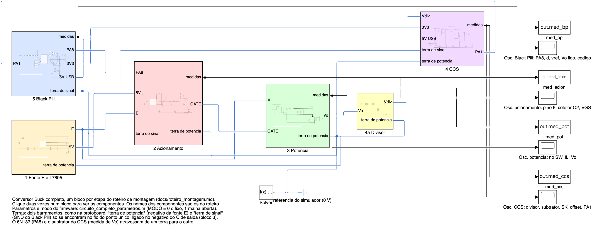

| Bloco | Dentro | Ligações com os outros |
|---|---|---|
| 1 Fonte E e L7805 | Fonte de bancada E (com 0,1 Ω dos fios); L7805 como CI de 3 pinos; 10 µF + 100 nF na entrada e na saída do L7805 | E, 5V, terra de potência |
| 2 Acionamento | R_LED, R_PD, 6N137 (como um CI com os pinos 2, 3, 5, 6, 7 e 8), 100 nF entre os pinos 8 e 5, R_P, R_1, R_BE1, Q1, R_P2, R_B, R_BE2, Q2, R_C, R_GS, zener | PA8, 5V, E → GATE; terra de sinal e terra de potência |
| 3 Potência | 470 µF + 1 µF de entrada, IRF9530, FCH20A20, sensor iL (onde vai o shunt), L, C 4,7 µF, C 1 µF, R47 (46,6 Ω, sem os 3k9 desde 2026-11-26) | E, GATE → Vo; terra de potência (é aqui o ponto único) |
| 4a Divisor | R1 = 10k + 1k em série, R2 = 1k. Na placa, fica perto do C de saída | Vo → Vdiv; terra de potência |
| 4 CCS | Subtrator, Sallen-Key (1k5, 1k5, 220n, 22n), offset (Rx 6k8 + 680, Ry 1k, Rb 8k2 + 820), 100 Ω; alimentação do LM324 no 5V do USB, com 100 nF entre os pinos 4 e 11 | Vdiv, 3V3, 5V USB → PA1; terra de sinal e, só no Ri do subtrator, terra de potência |
| 5 Black Pill | ADC de 12 bits amostrado no início do período, firmware (MATLAB Function com a mesma conta da `ADC_IRQHandler`), preload do CCR1, TIM1, o pino PA8 (0/3,3 V), o 3,3 V e o 5 V do USB | PA1 → PA8, 3V3, 5V USB; terra de sinal |

Os resistores em série do roteiro (por exemplo Ri = 100k + 820 + 82) aparecem como blocos separados, do jeito que vão na placa.

- **Medidas:** cada bloco tem uma saída "medidas" ligada a um osciloscópio (Scope) no topo do modelo e a uma variável no workspace.
- **Terras:** são fios, como na protoboard. Cada bloco tem a porta "terra de potência" e/ou "terra de sinal", e no topo os dois barramentos só se encontram num fio, o do **ponto único**, que chega no bloco 3 (negativo do C de saída). O único símbolo de terra do modelo é a "referência do simulador", ao lado do Solver, também nesse ponto. Ver também a seção "Terras e referências" do [roteiro](roteiro_montagem.md).

### Simplificações

- **6N137:** o modelo tem o LED (1,5 V em 10 mA) e a fotocorrente na base de um transistor de saída de coletor aberto. O componente real tem um amplificador no meio, mas o comportamento nos pinos é o mesmo: LED aceso → pino 6 baixo.
- **L7805:** 5 V com 0,05 Ω de saída e ~5 mA de consumo na entrada. A corrente da saída não aparece na entrada (no real ela vem de E).
- **6N137 e LM324:** o consumo aparece como um resistor entre VCC e GND (~10 mA e ~1 mA).
- **3,3 V e 5 V do Black Pill:** fontes ideais (o 5 V com 0,2 Ω do cabo USB).
- **LM324:** ganho de 10⁵, com a saída limitada a 0,02–3,5 V, como acontece alimentado em 5 V. A banda de 1 MHz não está modelada.
- **IRF9530:** R_DS(on) de 0,3 Ω, V_th de −3 V, C_iss de 760 pF e C_rss de 140 pF, sem o diodo de corpo.
- **PA9:** o PWM da referência para o filtro RC fica fora do modelo.

Por dentro:

| Fonte E e capacitores | L7805 |
|---|---|
| 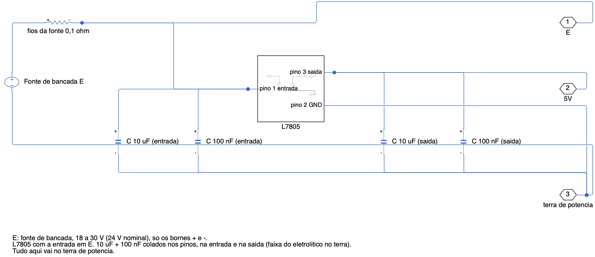 | 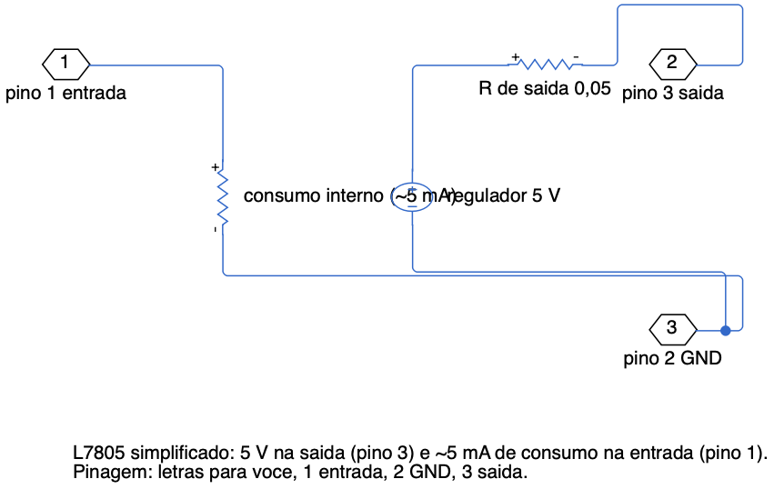 |

| Acionamento | 6N137 |
|---|---|
| 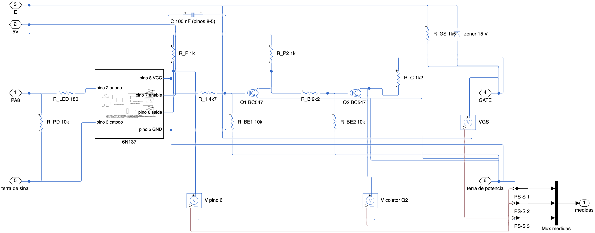 | 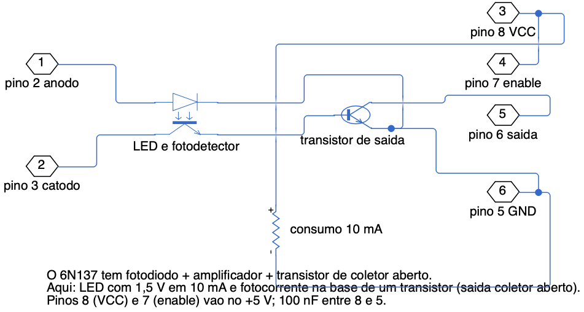 |

| Divisor | Potência |
|---|---|
| 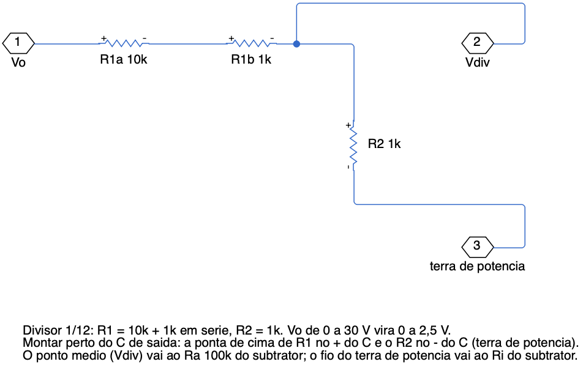 | 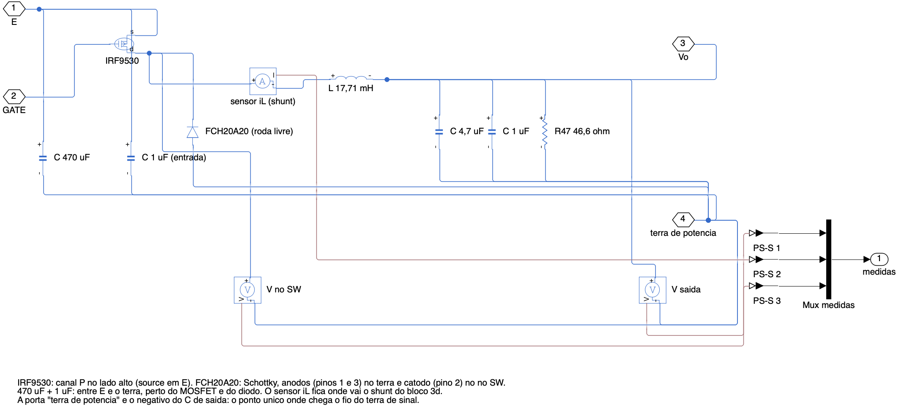 |

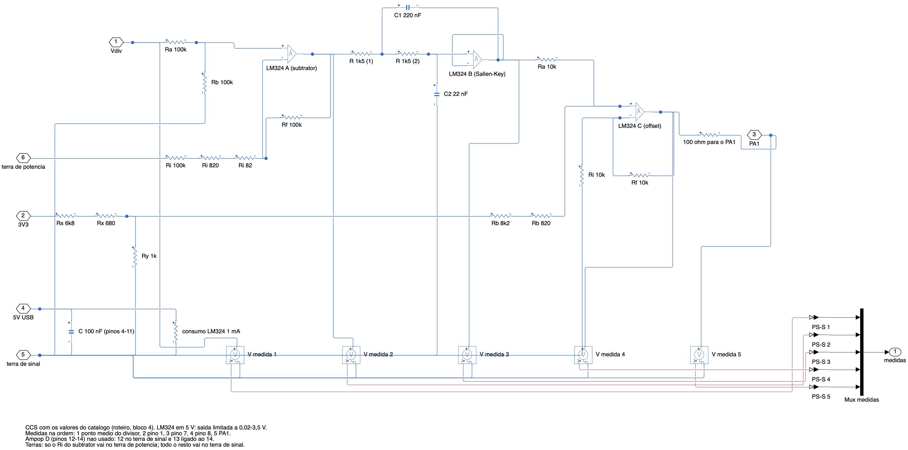

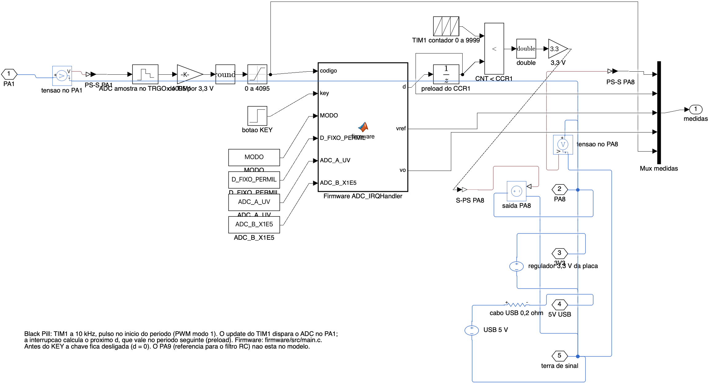

## Caso 1: d fixo = 0,5, E = 24 V (blocos 2 a 6 do roteiro)

O KEY é apertado em 1 ms; antes disso a chave fica desligada.

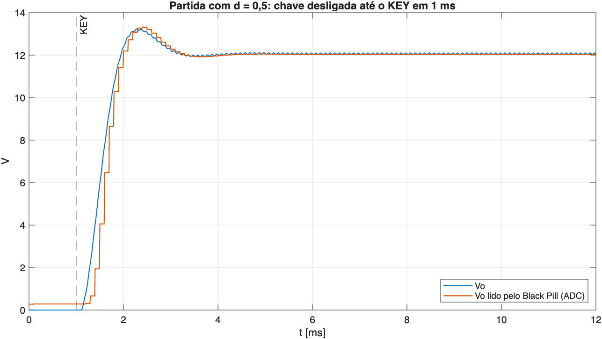

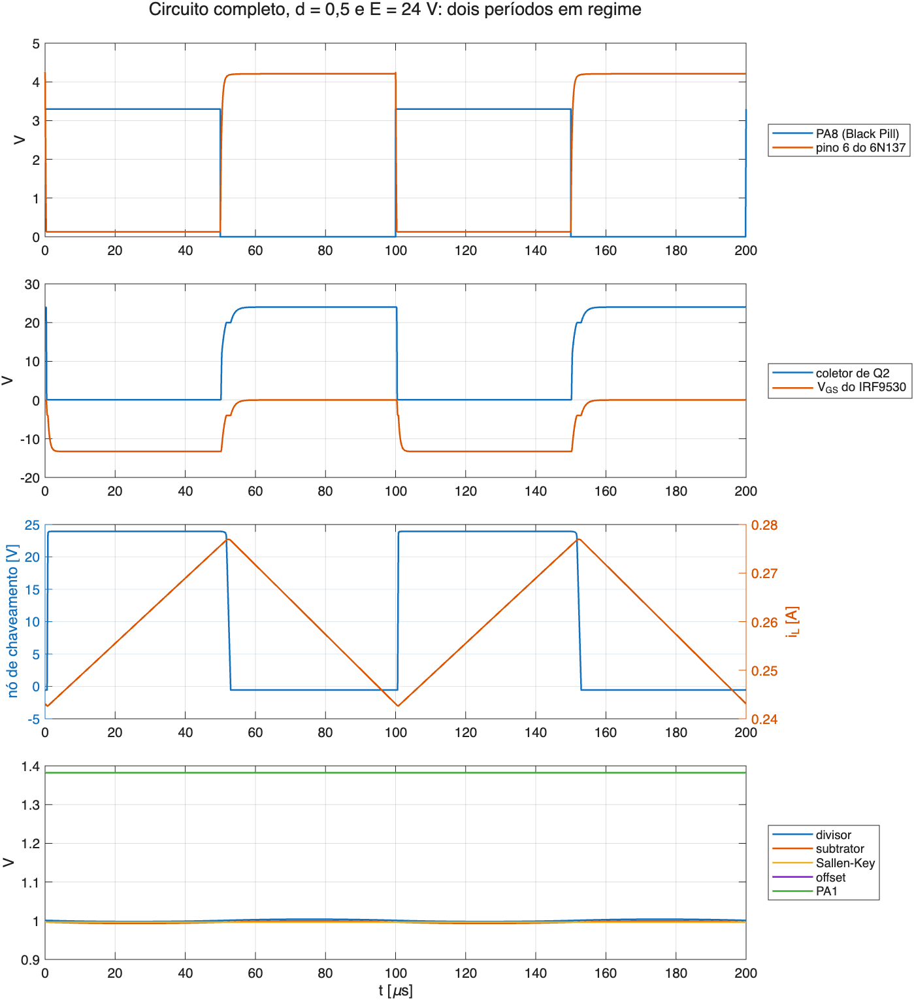

Valores esperados em regime, para comparar na bancada:

| Bloco do roteiro | Ponto | Chave ligada | Chave desligada |
|---|---|---|---|
| 2 | Pino 6 do 6N137 | 0,13 V | 4,21 V |
| 2 | Coletor de Q2 | 0,06 V | 24,0 V |
| 2 | V_GS do IRF9530 | −13,3 V | 0 V |
| 3 | Nó de chaveamento | 23,93 V | −0,56 V (diodo) |

| Bloco do roteiro | Ponto | Valor |
|---|---|---|
| 3 | i_L média / ripple | 0,260 A / 34 mA pp |
| 3 | Vo médio / ripple | 12,06 V / 76 mV pp |
| 3 | Subida / descida no nó de chaveamento | 0,2 µs / 1,0 µs |
| 4 | Ponto médio do divisor | 1,001 V |
| 4 | Saída do subtrator (pino 1) e do Sallen-Key (pino 7) | 0,996 V |
| 4 | Saída do offset (pino 8) = PA1 | 1,382 V |
| 5 | Código do ADC / Vo reconstruído | 1715 / 12,03 V |

Leitura:

- **Vo:** dá 12,06 V, um pouco acima de d·E = 12 V. A queda no MOSFET e no indutor é menor que o ganho do desligamento lento, que alonga o pulso.
- **Tempos:** o modelo do MOSFET dá tempos menores que a estimativa de 1,4 µs e 5,7 µs do [acionamento](acionamento_chave.md), porque não inclui toda a carga de gate do componente real. Na bancada devem aparecer tempos maiores.
- **ADC:** o Vo reconstruído pelo firmware erra 30 mV, uns 3 códigos do ADC. É o efeito da calibração a = 0,389 V e b = 0,08251 com os resistores do catálogo; na bancada isso se corrige com os valores medidos.

## Caso 2: Sinal 1 em malha aberta (bloco 6, passo 4)

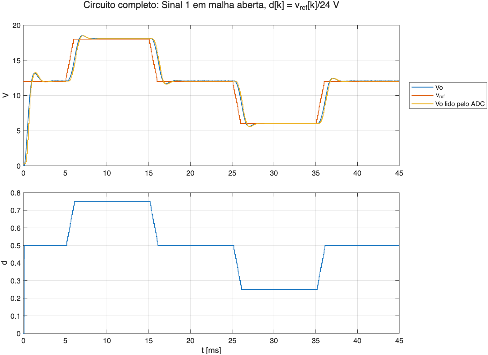

| v_ref | Vo médio | Erro | Vo lido pelo ADC |
|---|---|---|---|
| 12 V | 12,05 V | +0,05 V | 12,03 V |
| 18 V | 18,12 V | +0,12 V | 18,07 V |
| 12 V | 12,06 V | +0,06 V | 12,03 V |
| 6 V | 6,00 V | 0,00 V | 6,00 V |

Em malha aberta o erro fica abaixo de 0,13 V. A simulação só com as perdas, na [Etapa 2](etapa02_projeto_buck.md), dava cerca de 0,35 V **abaixo**. Aqui o desligamento mais lento do gate compensa as perdas. Na bancada o resultado deve ficar entre os dois.

## Como usar

- **Rodar tudo de novo:** `circuito_completo` no MATLAB, dentro de `matlab/`.
- **Simular à mão:** abra `buck_circuito_completo.slx`, mude `MODO`, `E` ou `D_FIXO_PERMIL` em `circuito_completo_parametros.m`, rode o arquivo e aperte Run. Os osciloscópios ficam no topo do modelo.
- **Testar um defeito de montagem:** troque um valor ou desfaça uma ligação no modelo e veja o que muda nos pontos de medida. Exemplos: tirar o Q1 e ver a lógica do PWM inverter, ou inverter o zener e ver o V_GS cair.
