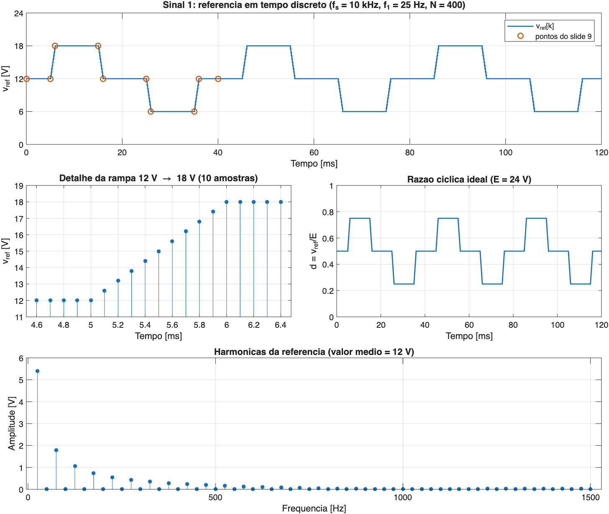

# Etapa 1 — Sinal de referência (Sinal 1)

Item 1 do enunciado: gerar por programação o sinal de referência periódico da tensão de saída e avaliá-lo no MATLAB.

Arquivos: [referencia_sinal1.m](../matlab/referencia_sinal1.m) (a função que gera o sinal) e [etapa01_referencia.m](../matlab/etapa01_referencia.m) (o script que avalia e plota).

## O sinal

Lido do slide 9 do WP2. A frequência de amostragem é a de chaveamento, 10 kHz, então cada amostra vale 0,1 ms e um ciclo de 40 ms tem N = 400 amostras.

| Amostras k | Tempo [ms] | Etapa |
|---|---|---|
| 0 a 49 | 0 a 5 | patamar 12 V |
| 50 a 59 | 5 a 6 | rampa 12 → 18 V |
| 60 a 149 | 6 a 15 | patamar 18 V |
| 150 a 159 | 15 a 16 | rampa 18 → 12 V |
| 160 a 249 | 16 a 25 | patamar 12 V |
| 250 a 259 | 25 a 26 | rampa 12 → 6 V |
| 260 a 349 | 26 a 35 | patamar 6 V |
| 350 a 359 | 35 a 36 | rampa 6 → 12 V |
| 360 a 399 | 36 a 40 | patamar 12 V |

Cada rampa tem 10 amostras, com passo de 0,6 V por amostra.

## Como foi gerado

A função usa um contador `k` que reinicia a cada N amostras (`mod(k, N)`) e uma condicional por etapa. É a mesma lógica que os slides da Atividade 1 pedem para o microcontrolador, então o código em C sai quase direto dela.

O script confere automaticamente (`assert`) que o sinal passa pelos 10 pontos marcados no slide.

## Resultados

- Valor médio de 12 V, mínimo de 6 V e máximo de 18 V.
- Com E = 24 V, a razão cíclica ideal em malha aberta (d = v_ref / E) vai de 0,25 a 0,75.
- Só existem harmônicas ímpares, porque a metade negativa do ciclo é o espelho da positiva.

| Harmônica | Frequência [Hz] | Amplitude [V] | Potência CA acumulada |
|---|---|---|---|
| 1 | 25 | 5,40 | 83,7 % |
| 3 | 75 | 1,78 | 92,8 % |
| 5 | 125 | 1,05 | 96,0 % |
| 7 | 175 | 0,73 | 97,5 % |
| 9 | 225 | 0,55 | 98,4 % |
| 11 | 275 | 0,43 | 99,0 % |
| 13 | 325 | 0,35 | 99,3 % |

## O que isso diz para a Etapa 2

- 99 % da potência CA do sinal está até 325 Hz. O filtro LC precisa deixar passar essa faixa com pouca atenuação e pouca fase.
- Pelo método da banda passante do slide 4, f_LC = √(f₁·fₛ) = √(25 · 10000) = 500 Hz, o que fica acima dessa faixa.
- As rampas duram 1 ms, da mesma ordem do tempo de subida de um filtro de 500 Hz. Em malha aberta a saída vai arredondar os cantos; isso será medido na Etapa 4.

## Falta nesta etapa

- Parte de bancada: gerar o PWM com esta referência no Black Pill, passar por um filtro passa-baixas e registrar forma e frequência no osciloscópio. O firmware da Atividade 1 já tem o modo trapézio e serve de base (lá o PWM era de 20 kHz; aqui passa a 10 kHz).
