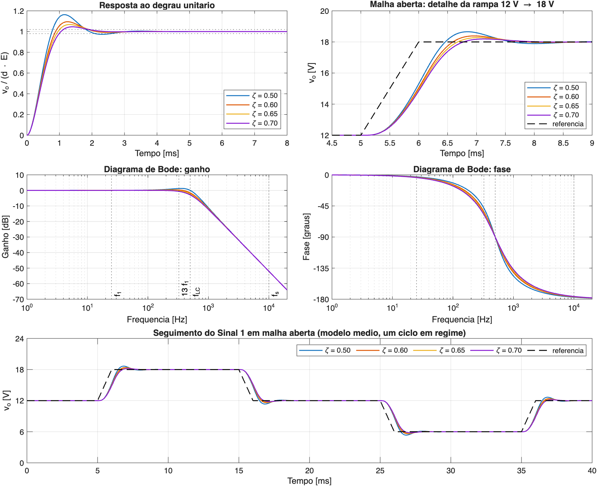
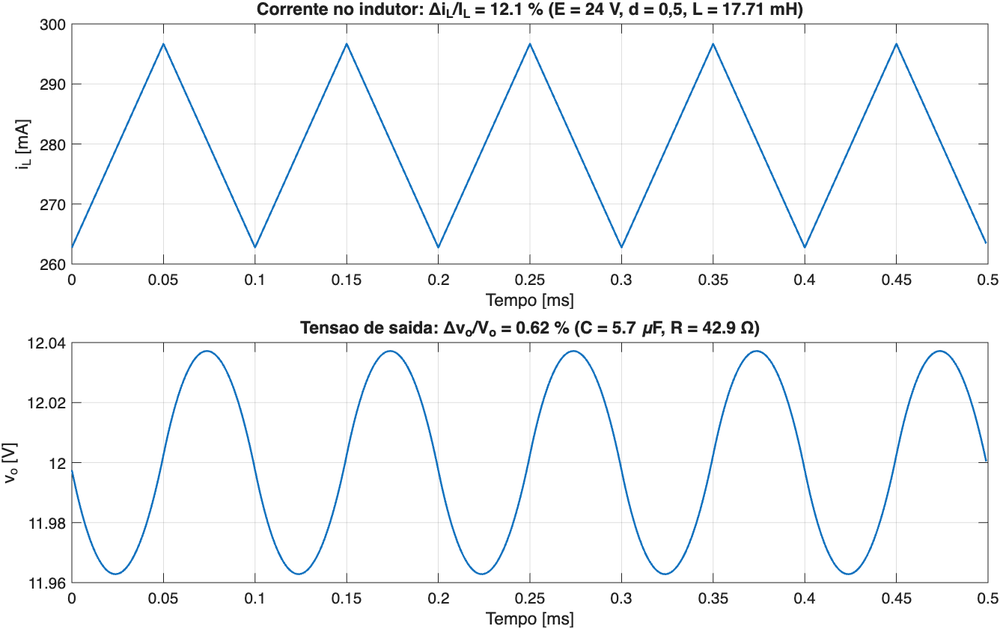
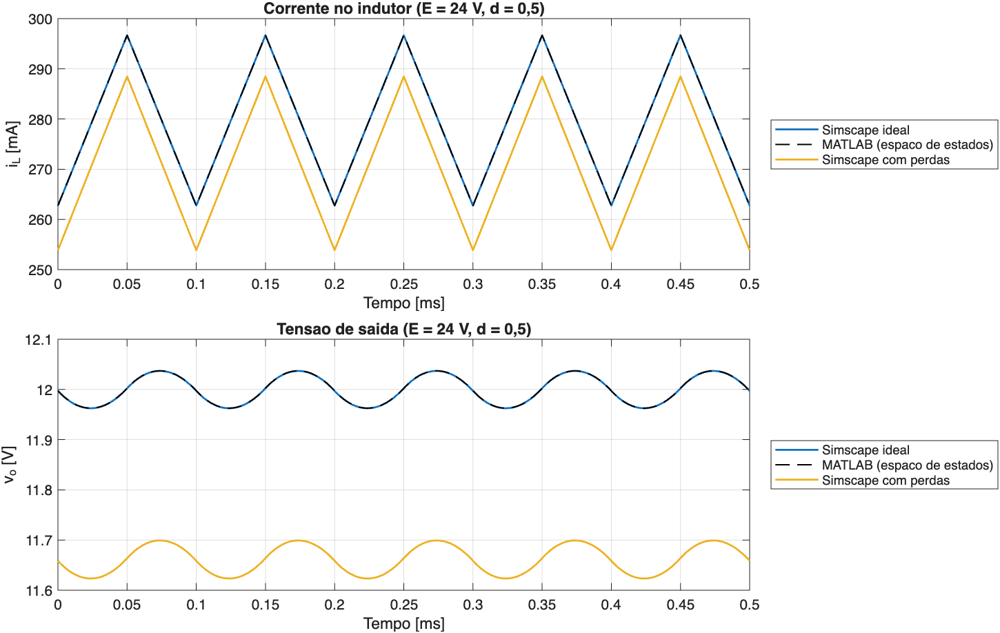
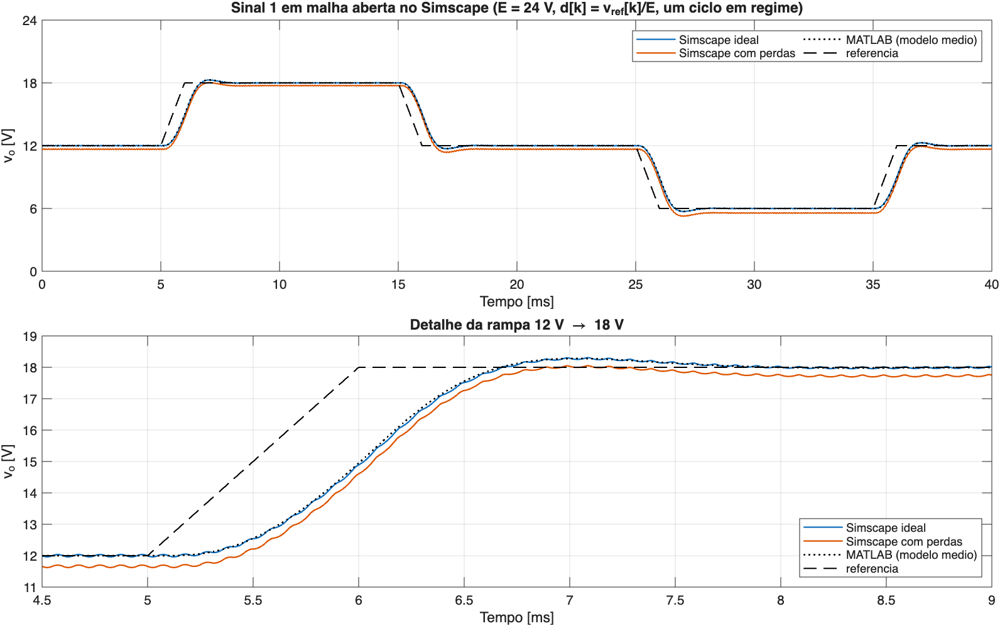

# Etapa 2 — Projeto do conversor Buck (L, C e amortecimento)

Item 2 do enunciado: projetar o conversor e verificar por simulação a banda passante, a condução contínua, o ripple de corrente (< 50 %) e o ripple de tensão (< 2 %).

Arquivo: [etapa02_projeto_buck.m](../matlab/etapa02_projeto_buck.m).

**Situação (2026-11-24): projeto feito com o indutor real do grupo, L = 17,71 mH.** Valores finais: **R = 42,9 Ω (39 Ω + 3,9 Ω), C = 5,7 µF (4,7 µF + 1 µF), ζ = 0,650, f_LC = 500,9 Hz.** Falta medir a resistência do fio do indutor e repetir no Simulink.

## Método

Método da banda passante (WP2, slide 4). O filtro LC com a carga R é um sistema de 2ª ordem:

```
G(s) = ω² / (s² + 2ζω·s + ω²)      ω = 1/√(LC)      ζ = (1/2R)·√(L/C)
```

1. A frequência de corte fica no meio geométrico entre a fundamental e o chaveamento: f_LC = √(f₁·fₛ) = √(25 · 10000) = 500 Hz.
2. Com o indutor fixo (L = 17,71 mH), C sai só de f_LC e R sai do ζ: C = 1/(Lω²) = 5,72 µF e R = Lω/(2ζ).

Orientação do professor (2026-11-10): partir de ζ = 0,5 e testar qual valor descreve melhor o amortecimento. O script varre ζ = 0,5 / 0,6 / 0,65 / 0,7; o grupo escolheu **ζ = 0,65**.

## Comparação dos amortecimentos (L = 17,71 mH, f_LC = 500 Hz)



| ζ | R [Ω] | C [µF] | Sobressinal | Subida 10–90 % | Acomodação 2 % | Pico de ressonância |
|---|---|---|---|---|---|---|
| 0,5 | 55,64 | 5,72 | 16,3 % | 0,52 ms | 2,57 ms | +1,25 dB |
| 0,6 | 46,36 | 5,72 | 9,5 % | 0,59 ms | 1,89 ms | +0,35 dB |
| **0,65** | **42,80** | **5,72** | **6,8 %** | **0,63 ms** | **1,91 ms** | **+0,11 dB** |
| 0,7 | 39,74 | 5,72 | 4,6 % | 0,68 ms | 1,90 ms | 0 dB |

A atenuação em fₛ = 10 kHz é de −52 dB para todos, porque depende só de f_LC.

Fase nas harmônicas que importam (ver Etapa 1: 99 % da potência CA está até 325 Hz):

| ζ | 25 Hz | 125 Hz | 325 Hz |
|---|---|---|---|
| 0,5 | −2,9° | −14,9° | −48,4° |
| 0,6 | −3,4° | −17,7° | −53,5° |
| **0,65** | **−3,7°** | **−19,1°** | **−55,7°** |
| 0,7 | −4,0° | −20,5° | −57,6° |

Seguimento do Sinal 1 em malha aberta, com a referência usada direto como ação de controle (modelo médio, sem chaveamento):

| ζ | Erro RMS | Erro máximo | Pico da saída (patamar de 18 V) |
|---|---|---|---|
| 0,5 | 0,78 V | 2,78 V | 18,66 V |
| 0,6 | 0,82 V | 2,96 V | 18,39 V |
| **0,65** | **0,84 V** | **3,06 V** | **18,28 V** |
| 0,7 | 0,86 V | 3,16 V | 18,19 V |

### Leitura

- Não há um ζ que ganhe em tudo. ζ menor atrasa menos (menos fase, erro RMS menor), mas ultrapassa mais o patamar e amplifica as harmônicas perto de 500 Hz. ζ maior faz o contrário.
- O erro em malha aberta é dominado pelo atraso do filtro nas rampas de 1 ms, e muda pouco com ζ (0,78 a 0,86 V RMS). O que muda bastante é o sobressinal (de 18,7 V para 18,2 V no patamar de 18 V).
- ζ = 0,65 (escolha do grupo): sobressinal de 6,8 % (0,28 V no patamar de 18 V), pico de ressonância quase nulo (+0,11 dB) e fase de −56° em 325 Hz. Custa só 0,06 V a mais de erro RMS que ζ = 0,5.
- A escolha final do amortecimento só fecha em malha fechada (Etapas 8 e 9), porque o controlador muda o atraso e o sobressinal. O item 9 do enunciado também pede o teste com +30 % de amortecimento, ou seja, ζ ≈ 0,85.
- No circuito real o amortecimento será maior que o calculado, porque a resistência do fio do indutor e a do MOSFET entram em série. Medir a resistência do fio do indutor: cada 1 Ω em série soma cerca de (1/2)·√(C/L) ≈ 0,009 ao ζ.

## Verificação com o conversor chaveado (L = 17,71 mH, C = 5,7 µF, R = 42,9 Ω)

Valores comerciais dão f_LC = 500,9 Hz e ζ = 0,650. Simulação com chave e diodo ideais, 100 pontos por período de chaveamento. Entre parênteses, o valor teórico: Δi_L = E·d·(1−d)/(L·fₛ) e Δv_o/V_o = (1−d)/(8·L·C·fₛ²).



| E [V] | d | V_o [V] | I_L [A] | I_L mínima [A] | Ripple de corrente | Ripple de tensão |
|---|---|---|---|---|---|---|
| 24 | 0,50 | 12,0 | 0,280 | 0,263 | 12,1 % (12,1) | 0,62 % (0,62) |
| 24 | 0,25 | 6,0 | 0,140 | 0,127 | 18,2 % (18,2) | 0,93 % (0,93) |
| 24 | 0,75 | 18,0 | 0,420 | 0,407 | 6,1 % (6,1) | 0,31 % (0,31) |
| 30 | 0,20 | 6,0 | 0,140 | 0,126 | 19,4 % (19,4) | 0,99 % (0,99) |
| 30 | 0,60 | 18,0 | 0,420 | 0,399 | 9,7 % (9,7) | 0,50 % (0,50) |
| 18 | 0,50 | 9,0 | 0,210 | 0,197 | 12,1 % (12,1) | 0,62 % (0,62) |

| Critério | Resultado |
|---|---|
| Banda passante | f_LC = 501 Hz, acima das harmônicas do sinal (até 325 Hz) e −52 dB em fₛ |
| Condução contínua | Atendido: corrente mínima sempre positiva |
| Ripple de corrente < 50 % | Atendido: pior caso 19,4 % |
| Ripple de tensão < 2 % | Atendido: pior caso 0,99 % |

Correntes e potências para escolher as peças:

| Grandeza | Valor |
|---|---|
| Pico no indutor em operação (18 V) | 0,44 A |
| Pico com d = 1 e E = 30 V (saturação) | 0,70 A → o indutor precisa aguentar ≥ 0,7 A |
| Potência no 39 Ω | 6,9 W com 18 V; 19 W com 30 V e d = 1 |
| Potência no 3,9 Ω | 0,7 W com 18 V; 1,9 W com 30 V e d = 1 |

Esses ripples não dependem de R enquanto f_LC e ζ forem mantidos, então trocar a carga (e reescalar L e C) não muda a tabela.

## Verificação no Simulink/Simscape

Arquivos: [etapa02_simulink.m](../matlab/etapa02_simulink.m), que monta e roda o modelo [etapa02_buck_simscape.slx](../matlab/etapa02_buck_simscape.slx).

- **Modelo:** blocos da Simscape Foundation Library. Fonte E, chave no lado alto, diodo de roda livre, indutor com resistência do fio, C e carga R, além de sensores de i_L e v_o.
- **PWM:** dente de serra de 0 a 1 em Tₛ comparado com d[k]. A chave fica fechada enquanto serra < d, ou seja, o pulso fica no início do período, como no CA08.
- **Solver:** ode23t com passo máximo de 1 µs (100 pontos por período).

Duas versões do circuito:

| Versão | R | r_L | Chave (R_on) | Diodo |
|---|---|---|---|---|
| Ideal (validação) | 42,9 Ω | 0 | 1 mΩ | ideal |
| Com perdas (peças reais) | 43,0 Ω (46,6 Ω ‖ 7 × 3k9) | 0,07 Ω (medido) | 0,3 Ω (IRF9530, máximo) | V_f = 0,55 V, 0,03 Ω (FCH20A20, estimado) |

### Regime

| E [V] | d | V_o ideal | V_o com perdas | Ripple de corrente (ideal / perdas) | Ripple de tensão (ideal / perdas) |
|---|---|---|---|---|---|
| 24 | 0,50 | 12,00 V | 11,66 V | 12,1 % / 12,8 % | 0,62 % / 0,65 % |
| 24 | 0,25 | 6,00 V | 5,57 V | 18,2 % / 20,1 % | 0,93 % / 1,02 % |
| 24 | 0,75 | 18,00 V | 17,74 V | 6,1 % / 6,3 % | 0,31 % / 0,32 % |
| 30 | 0,20 | 6,00 V | 5,54 V | 19,4 % / 21,4 % | 0,99 % / 1,09 % |
| 30 | 0,60 | 18,00 V | 17,67 V | 9,7 % / 10,1 % | 0,50 % / 0,51 % |
| 18 | 0,50 | 9,00 V | 8,68 V | 12,1 % / 13,0 % | 0,62 % / 0,66 % |



- **Validação:** a versão ideal reproduz a tabela do MATLAB. V_o difere no máximo 1 mV, e os ripples são iguais.
- **Critérios:** as duas versões atendem CCM, ripple de corrente < 50 % e ripple de tensão < 2 %.
- **Efeito das perdas:** a saída cai de 0,26 a 0,46 V. A queda é maior com d pequeno, porque o diodo conduz mais tempo e o V_f pesa mais. Em malha aberta esse erro aparece direto; em malha fechada o integrador corrige, pedindo um d um pouco maior.

### Sinal 1 em malha aberta (E = 24 V, d[k] = v_ref[k]/E)



| Versão | Erro RMS | Erro máximo | V_o máx / mín | Diferença RMS para o modelo médio |
|---|---|---|---|---|
| Ideal | 0,84 V | 3,13 V | 18,27 / 5,71 V | 0,02 V |
| Com perdas | 0,91 V | 3,41 V | 18,02 / 5,27 V | 0,35 V |

- O conversor chaveado ideal segue o modelo médio da Etapa 2 com 0,02 V RMS de diferença, depois de filtrar o ripple. O modelo médio basta para as Etapas 4 a 9.
- **Perdas:** somam ~0,35 V de erro de regime em malha aberta.
- **Fonte em 18 V:** com perdas, o patamar de 18 V fica ainda mais fora de alcance (com E = 18 V e d = 1, a chave e o fio do indutor deixam ~17,8 V).

## Ponto de atenção: fonte em 18 V

Com o distúrbio de −6 V a fonte cai para 18 V, e o patamar de 18 V da referência exige d = 1 (chave sempre fechada). Na prática não dá para chegar lá, por causa das quedas na chave, no indutor e do limite do driver. Na Etapa 9 a saída vai saturar nesse trecho; vale perguntar ao professor se é o comportamento esperado.

## Falta nesta etapa

- Resistência do fio medida em 2026-11-24: **0,07 Ω**. Soma só 0,0006 ao ζ (0,650 → 0,651) e cai 0,03 V a 0,42 A: desprezível.
- Conferir que o indutor não satura até 0,7 A (teste com resistor shunt, abaixo) e medir o C real no LCR.

### Teste de saturação do indutor

Resistor shunt de 1 Ω / 1 W no retorno de terra: entre o negativo comum de C e R e o ponto onde se juntam o ânodo do diodo e o negativo da fonte. Ali passa exatamente i_L. Ponta do osciloscópio no shunt, com o terra da ponta no negativo da fonte (o sinal aparece invertido, 1 V = 1 A). Subir até E = 30 V com d = 1 (0,7 A) e olhar a forma de onda: rampas retas = sem saturação; rampa que entorta para cima no fim do período = núcleo saturando. Tirar o shunt depois do teste.
