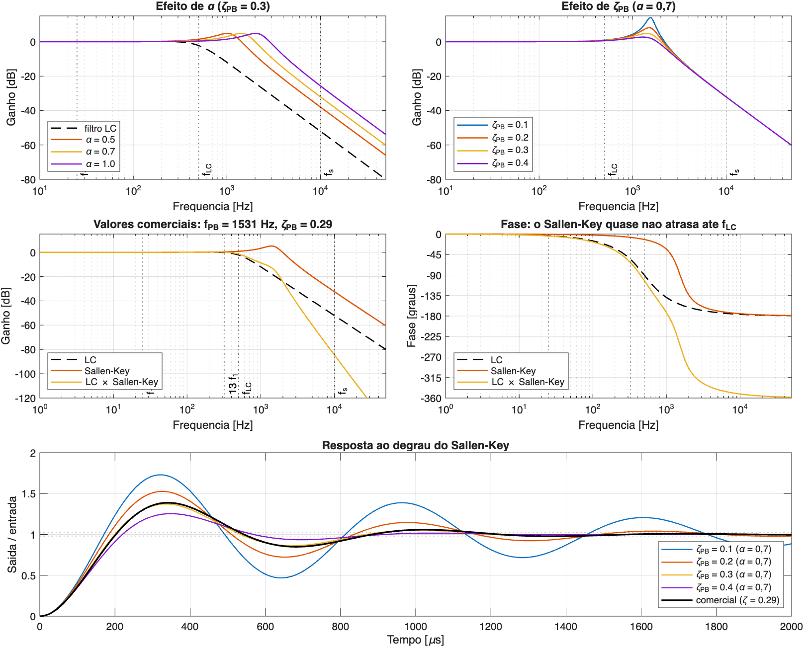
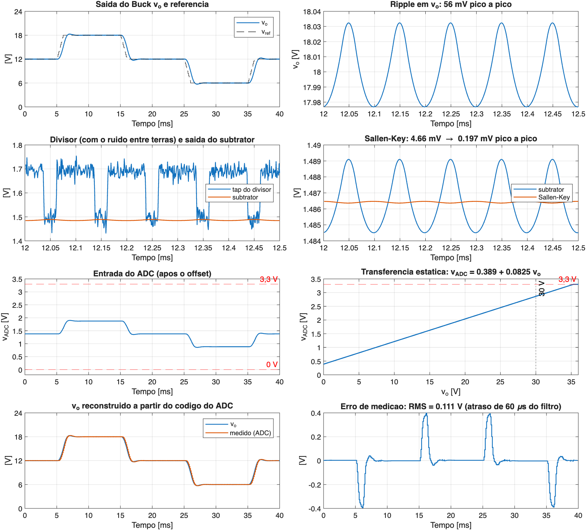

# Etapa 3 — Circuito de condicionamento de sinais (CCS)

Item 3 do enunciado: projetar o CCS e verificar por simulação cada circuito (atenuação, subtração, filtragem e offset).

Arquivo: [etapa03_projeto_ccs.m](../matlab/etapa03_projeto_ccs.m).

**Situação: projeto feito em MATLAB, com valores comerciais.** Faltam a confirmação dos ampops disponíveis e a repetição no Simulink. A simulação no tempo usa o Buck provisório (ζ = 0,65 com R = 47 Ω); trocar o indutor não muda o projeto do CCS, porque f_LC continua 500 Hz.

## Cadeia e níveis

```
Vo ──[divisor K]──[subtrator S]──[Sallen-Key F]──[offset O]──► ADC (PA1)
      R1, R2        ampop 1        ampop 2          ampop 3
```

Os níveis foram escolhidos pelo grupo (não seguem o slide 6):

| Ponto | Faixa |
|---|---|
| Saída do Buck | 0 a 30 V (30 V é a fonte no máximo do distúrbio) |
| Divisor e subtrator | 0 a 2,5 V |
| Entrada do ADC | 0,39 a 2,86 V, dentro de 0 a 3,3 V |

Ampops: sugestão de **MCP6004-I/P** (encapsulamento DIP-14, que encaixa na protoboard; quatro ampops rail-to-rail num chip, 1 MHz, alimentação única de 1,8 a 6 V), alimentados nos 3,3 V do Black Pill. Assim a entrada do ADC nunca sai de 0–3,3 V, mesmo com sobretensão. Usa 3 dos 4 ampops. Se o grupo não tiver: MCP6002-I/P (DIP-8, 2 por chip, precisa de dois chips). LM358 e TL072 não servem direto porque não chegam perto dos trilhos com 3,3 V.

## 1. Atenuação (divisor resistivo)

| Componente | Valor |
|---|---|
| R1 | 11 kΩ |
| R2 | 1 kΩ |

k = 1/12 = 0,08333 (exato). Resistência vista no ponto central: 917 Ω. Potência em R1 com 30 V: 69 mW (resistor de 1/4 W serve).

## 2. Subtração (medição diferencial, ganho 0 dB)

Mede a diferença entre o ponto central do divisor e o terra de potência, para que ruído entre o terra de potência e o terra de sinal não entre na medida.

| Componente | Valor |
|---|---|
| Ra, Rb, Rf | 100 kΩ |
| Ri | 100 kΩ + 910 Ω em série |

O resistor de 910 Ω compensa os 917 Ω do divisor que ficam em série com Ra. Sem ele a rejeição de modo comum cairia para cerca de 46 dB.

| Resultado | Valor |
|---|---|
| Ganho diferencial | 0,991 (−0,08 dB) |
| Impedância de entrada | 101 kΩ e 200 kΩ (mínimo pedido: 10 kΩ) |
| Rejeição de modo comum (CMRR) nominal | 90 dB |
| CMRR no pior caso com resistores de 1 % | 34 dB |

Na prática quem limita a rejeição é a tolerância dos resistores. Com 34 dB, 0,4 V de ruído entre terras viram cerca de 8 mV na saída do subtrator, e o Sallen-Key ainda atenua isso em 10 kHz. Se quiser melhorar, medir os quatro resistores de 100 kΩ e parear os mais próximos.

## 3. Filtragem (Sallen-Key passa-baixas, ganho unitário)

Slide 7: f_PB = α·√(fₛ·f_LC) com 0,5 < α < 1 e ζ_PB entre 0,1 e 0,4. Com fₛ = 10 kHz e f_LC = 500 Hz, √(fₛ·f_LC) = 2236 Hz.

Com R1 = R2 = R, as fórmulas do slide ficam ω = 1/(R·√(C1·C2)) e ζ = √(C2/C1), então C1 = C2/ζ².

### Varredura



| α | ζ_PB | f_PB [Hz] | Pico [dB] | Atenuação em fₛ | LC + filtro em fₛ | Fase em 325 Hz | Fase em 500 Hz |
|---|---|---|---|---|---|---|---|
| 0,5 | 0,1 | 1118 | +14,0 | −38,0 dB | −90,0 dB | −3,6° | −6,4° |
| 0,5 | 0,3 | 1118 | +4,9 | −38,0 dB | −90,0 dB | −10,8° | −18,5° |
| 0,7 | 0,1 | 1565 | +14,0 | −32,0 dB | −84,0 dB | −2,5° | −4,1° |
| 0,7 | 0,2 | 1565 | +8,1 | −32,0 dB | −84,1 dB | −5,0° | −8,1° |
| **0,7** | **0,3** | **1565** | **+4,9** | **−32,0 dB** | **−84,1 dB** | **−7,4°** | **−12,0°** |
| 0,7 | 0,4 | 1565 | +2,7 | −32,1 dB | −84,1 dB | −9,8° | −15,9° |
| 1,0 | 0,1 | 2236 | +14,0 | −25,6 dB | −77,6 dB | −1,7° | −2,7° |
| 1,0 | 0,3 | 2236 | +4,9 | −25,7 dB | −77,7 dB | −5,1° | −8,0° |

(A tabela completa, com todas as combinações, sai no console do script.)

### Leitura

- **α** troca atenuação do chaveamento por atraso: α = 0,5 atenua 6 dB a mais em 10 kHz, mas quase dobra a fase em 500 Hz em relação a α = 1.
- **ζ_PB** troca pico de ressonância por atraso. ζ = 0,1 quase não atrasa, mas tem pico de 14 dB em 1,5 kHz, que amplificaria ruído nessa faixa.
- **Escolha: α = 0,7 e ζ_PB = 0,3.** Fica no meio dos dois, com fase de só −12° em f_LC (o LC sozinho tem −90° nesse ponto).
- O pico de +4,9 dB do filtro fica em 1,5 kHz, onde o LC já atenua cerca de 20 dB. Por isso a curva combinada não tem pico, que é o que o slide 7 pede ("evitar a sobreposição dos picos").

### Valores comerciais

| Componente | Valor |
|---|---|
| R1 = R2 | 3,0 kΩ |
| C1 (realimentação) | 120 nF |
| C2 (para o terra) | 10 nF |

| Resultado | Valor obtido | Alvo |
|---|---|---|
| f_PB | 1531 Hz | 1565 Hz |
| ζ_PB | 0,289 | 0,3 |
| Atenuação em 10 kHz | −32,4 dB | — |
| Fase em 25 / 325 / 500 Hz | −0,5° / −7,3° / −11,9° | — |
| Atraso em baixa frequência | 60 µs (0,6 amostra) | — |
| Degrau: subida / acomodação 2 % | 135 µs / 1,4 ms | — |
| Degrau: sobressinal | 39 % | — |

O sobressinal de 39 % só aparece com um degrau ideal na entrada do filtro. Isso não acontece na prática: a tensão de saída já passa pelo LC de 500 Hz, que não deixa chegar ao Sallen-Key nada rápido o bastante para excitar a ressonância de 1,5 kHz. A simulação da cadeia confirma isso (abaixo).

Os capacitores devem ser de filme (poliéster/MKT, terminais radiais), que existem em 120 nF e 10 nF com facilidade. Cerâmicos comuns (X7R) mudam de valor com a tensão e deslocam f_PB e ζ.

## 4. Offset

Somador não inversor: Vo = V_offset + Vin2 − Vin1, com Vin1 no terra de sinal e V_offset tirado de um divisor nos 3,3 V.

| Componente | Valor |
|---|---|
| Ra, Rf, Ri | 10 kΩ |
| Rx (do 3,3 V) | 7,5 kΩ |
| Ry (para o terra) | 1 kΩ |
| Rb | 9,1 kΩ (compensa os 882 Ω do divisor Rx/Ry) |

Resultado: ganho de 0,999 e offset de 0,389 V (alvo de 0,4 V).

O offset serve para medir um pouco abaixo de zero e para afastar o sinal do trilho inferior do ampop. O desvio de 11 mV em relação ao alvo não importa: o firmware usa os valores calibrados (ver abaixo).

## Cadeia completa

**v_ADC = 0,389 V + 0,08251 · Vo**

| Resultado | Valor |
|---|---|
| Vo = 30 V no ADC | 2,86 V (sobra 0,44 V até 3,3 V) |
| Faixa medível | 0 a 35,3 V |
| Resolução | 9,8 mV de Vo por código do ADC |

No firmware, a tensão é reconstruída por Vo = (v_ADC − 0,389)/0,08251. Os dois números devem ser **calibrados na bancada** (medir v_ADC com Vo em dois valores conhecidos), porque a tolerância dos resistores muda os dois alguns por cento.

## Simulação da cadeia com o conversor chaveado

Malha aberta com o Sinal 1, PWM centrado como no Black Pill (ADC amostrado no vale do contador). Para testar o subtrator foi somada uma diferença entre o terra de potência e o terra de sinal: 0,2 V durante a condução da chave, mais 20 mV de ruído aleatório.



Ripple e ruído no patamar de 18 V (pico a pico):

| Ponto | Ripple |
|---|---|
| Saída do Buck | 56 mV |
| Ruído entre os terras | 389 mV |
| Saída do subtrator | 4,7 mV (é o ripple de Vo × 1/12; o ruído entre terras virou 0,013 mV) |
| Saída do Sallen-Key | 0,20 mV |
| Entrada do ADC | 0,20 mV, menos de 1 código (1 código = 0,8 mV) |

Erro da medida (Vo reconstruído do código do ADC menos o valor médio de Vo em cada período):

| Resultado | Valor |
|---|---|
| Erro nos patamares | Praticamente zero (abaixo de 1 código) |
| Erro máximo, nas rampas | 0,40 V |
| Erro RMS no ciclo | 0,11 V |

O erro nas rampas é o atraso de 60 µs do filtro: com a rampa de 6 V/ms, 60 µs dão 0,36 V. É pequeno perto de um período de amostragem (100 µs) e será levado em conta no projeto do controlador.

## Verificação dos critérios

| Circuito | O que se pede | Resultado |
|---|---|---|
| Atenuação | Levar 0–30 V a um nível compatível com os ampops | 0–2,5 V, k exato |
| Subtração | Ganho 0 dB, impedância ≥ 10 kΩ, medição diferencial | −0,08 dB, ≥ 101 kΩ, CMRR de 90 dB (34 dB no pior caso) |
| Filtragem | f_PB acima de f_LC, amortecimento que não acentue a fase | 1531 Hz, −12° em f_LC, −32 dB em fₛ |
| Offset | Ajustar o sinal à faixa do ADC | 0,39–2,86 V, protegido pelos trilhos de 3,3 V |

## Falta nesta etapa

- O grupo confirmar os ampops (MCP6004-I/P ou equivalente rail-to-rail em DIP) e os capacitores de 120 nF e 10 nF de filme.
- Repetir no Simulink, com os circuitos dos ampops.
- Na bancada: calibrar o ganho e o offset da cadeia em dois pontos.
