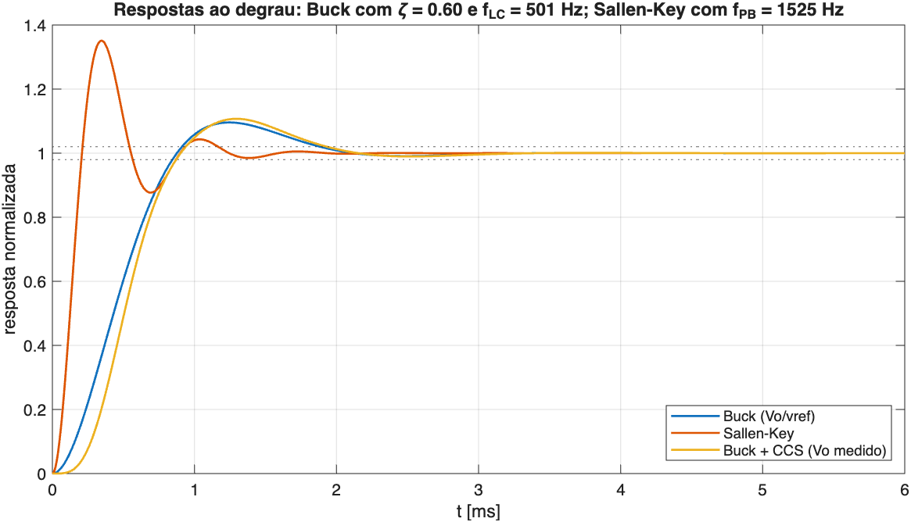
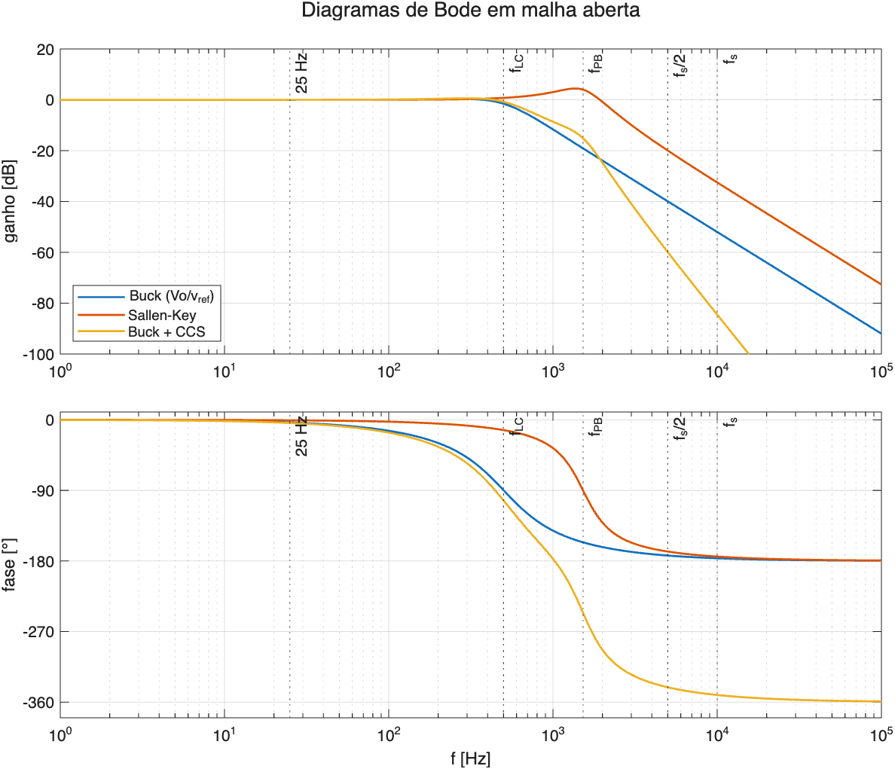
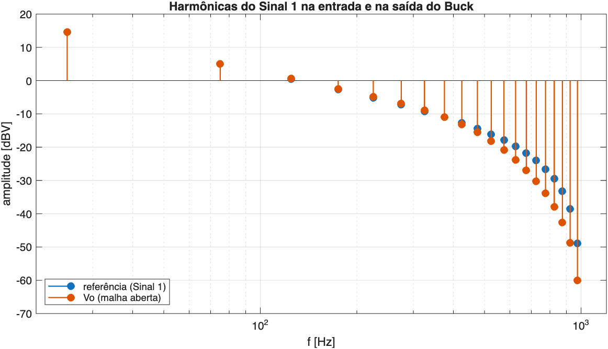
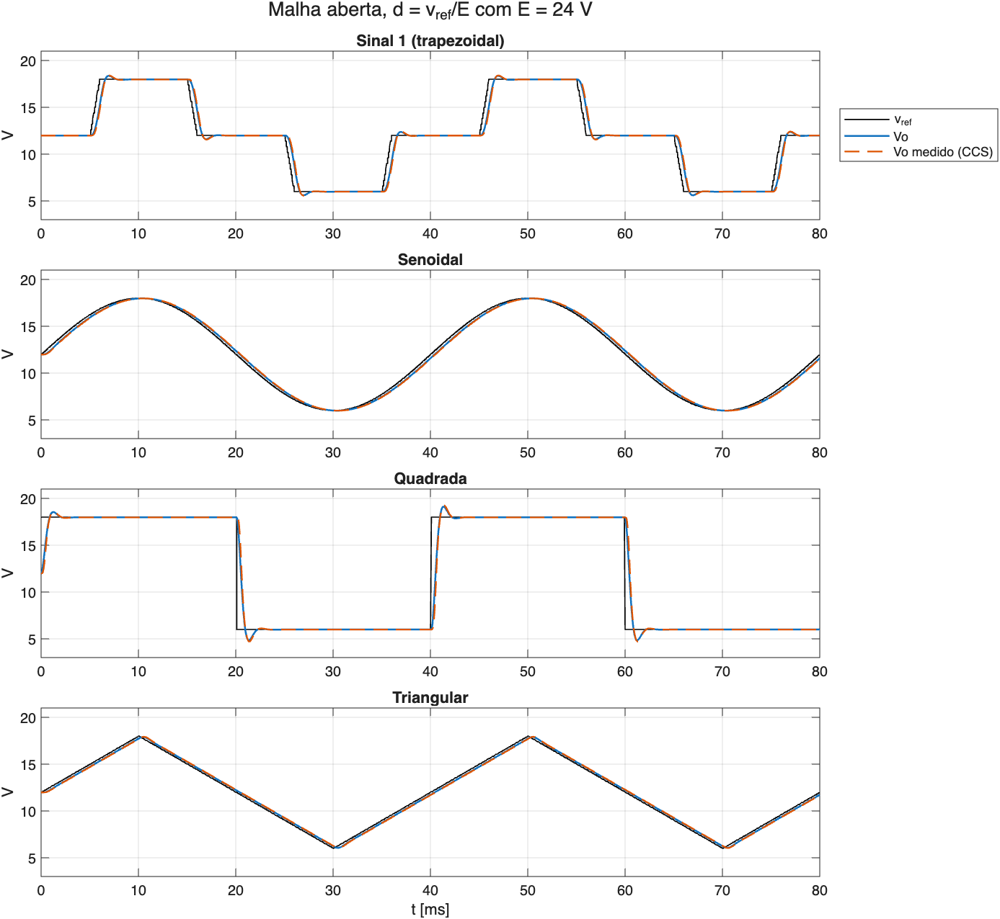

# Etapa 4 — Análise em malha aberta do Buck e do CCS

Item 4 do enunciado. Analisa o Buck e o CCS com os componentes que foram montados:

| Grandeza | Valor |
|---|---|
| L | 17,71 mH, com 0,07 Ω |
| C | 5,7 µF |
| R | 46,6 Ω (só o resistor de potência, decisão de 2026-11-26) |
| Sallen-Key | 1,5 kΩ / 220 nF / 22 nF |
| Cadeia do CCS | v_ADC = 0,389 + 0,08251·Vo |

Arquivo: [etapa04_malha_aberta.m](../matlab/etapa04_malha_aberta.m). Ele usa os modelos médios (funções de transferência contínuas); o chaveamento entra só como a harmônica de 10 kHz na seção 3.

| Bloco | Função de transferência |
|---|---|
| Buck, malha aberta com d = v_ref/E | G(s) = 1 / (LC·s² + (L/R + r_L·C)·s + 1 + r_L/R) |
| Sallen-Key | F(s) = ω_PB² / (s² + 2ζ_PB·ω_PB·s + ω_PB²) |
| CCS (sem o offset) | H(s) = 0,08251·F(s) |
| Vo medido (reconstruído pelo firmware) | G(s)·F(s) |

Parâmetros que saem dos componentes:

| Bloco | Parâmetros |
|---|---|
| Buck | f_LC = 500,9 Hz, ζ = 0,599, ganho CC = 0,998 (queda no r_L) |
| Sallen-Key | f_PB = 1525 Hz, ζ_PB = 0,316 |
| ADC | 1 código = 0,806 mV no ADC = 9,8 mV de Vo |

## 1. Respostas ao degrau

| Sistema | Subida (10–90 %) | Acomodação (2 %) | Sobressinal | Pico em |
|---|---|---|---|---|
| Buck (Vo/v_ref) | 0,59 ms | 1,89 ms | 9,6 % | 1,25 ms |
| Sallen-Key sozinho | 0,14 ms | 1,17 ms | 35,1 % | 0,35 ms |
| Buck + CCS (Vo medido) | 0,50 ms | 1,93 ms | 10,7 % | 1,30 ms |

- **Buck:** um degrau de 6 V, como os do Sinal 1 sem as rampas, passa 0,57 V do patamar e acomoda em menos de 2 ms. Os patamares do Sinal 1 duram 9 ms, então há tempo de sobra para acomodar.
- **Sallen-Key:** sozinho tem 35 % de sobressinal (ζ = 0,316), mas isso não aparece na medida. O LC na frente não deixa passar nada rápido o bastante para excitar a ressonância de 1,5 kHz.
- **Buck + CCS:** a medida acrescenta só 1,1 ponto percentual de sobressinal e 0,04 ms na acomodação.

## 2. Diagramas de Bode

| f | Buck | Sallen-Key | Buck + CCS |
|---|---|---|---|
| 25 Hz (fundamental) | −0,01 dB / −3,4° | 0,00 dB / −0,6° | −0,01 dB / −4,0° |
| 125 Hz (5ª) | +0,13 dB / −17,6° | +0,05 dB / −3,0° | +0,17 dB / −20,6° |
| 250 Hz | +0,35 dB / −38,5° | +0,19 dB / −6,1° | +0,53 dB / −44,5° |
| 500 Hz (f_LC) | −1,55 dB / −89,8° | +0,76 dB / −13,1° | −0,79 dB / −102,8° |
| 1525 Hz (f_PB) | −19,1 dB / −156,2° | +3,98 dB / −90,0° | −15,1 dB / −246,2° |
| 5 kHz (fₛ/2) | −39,9 dB / −173,1° | −20,0 dB / −168,0° | −59,9 dB / −341,1° |
| 10 kHz (fₛ) | −52,0 dB / −176,6° | −32,5 dB / −174,4° | −84,5 dB / −350,9° |

**Bandas passantes (−3 dB):** 576 Hz no Buck e 634 Hz no Buck com o CCS.

- **Ganho até ~300 Hz:** o Buck fica quase plano (pico de +0,35 dB perto de 250 Hz, efeito do ζ = 0,60), então em malha aberta as harmônicas do Sinal 1 que importam passam sem mudar de amplitude.
- **Fase:** atrasa 3,4° em 25 Hz e 18° em 125 Hz. Isso dá cerca de 0,4 ms de atraso, que aparece como erro nas rampas (seção 4).
- **Sallen-Key na malha:** o pico de +4 dB fica onde o LC já atenua quase 20 dB, então a curva combinada não tem pico. Em compensação, o filtro soma 13° de atraso em f_LC, e isso entra na margem de fase do controlador (Etapa 8).

## 3. Tensões, harmônicas e ruído de medida

### Tensões de entrada e saída

| E | Vo = 6 V | Vo = 12 V | Vo = 18 V |
|---|---|---|---|
| 18 V | d = 0,333 | d = 0,667 | d = **1,000** (saturado; decisão do grupo: esperado) |
| 24 V | d = 0,250 | d = 0,500 | d = 0,750 |
| 30 V | d = 0,200 | d = 0,400 | d = 0,600 |
| **ADC** | 0,883 V (código 1096) | 1,378 V (1709) | 1,872 V (2323) |

A faixa do ADC vai de 0,389 V (Vo = 0) a 2,864 V (Vo = 30 V), dentro de 0 a 3,3 V.

### Harmônicas do Sinal 1

| n | f | Na referência | Ganho do Buck | Em Vo |
|---|---|---|---|---|
| 1 | 25 Hz | 5,40 V | −0,01 dB | 5,39 V |
| 3 | 75 Hz | 1,78 V | +0,04 dB | 1,79 V |
| 5 | 125 Hz | 1,05 V | +0,13 dB | 1,07 V |
| 7 | 175 Hz | 0,73 V | +0,23 dB | 0,75 V |
| 9 | 225 Hz | 0,55 V | +0,32 dB | 0,57 V |
| 15 | 375 Hz | 0,28 V | +0,01 dB | 0,28 V |

- **Simetria:** o Sinal 1 tem simetria de meia onda, então as harmônicas pares são nulas.
- **Conteúdo harmônico:** é alto, 44 % da fundamental, por causa dos degraus. Quase todo ele fica abaixo de f_LC e chega a Vo, que é o que se quer: a forma do Sinal 1 precisa ser reproduzida.
- **Limite do Buck:** acima de 500 Hz ele começa a cortar as harmônicas. Isso arredonda as quinas das rampas.

### Harmônica do chaveamento (10 kHz), com d = 0,5

| E | No nó de chaveamento | Em Vo (amplitude) | No ADC (amplitude) | Em códigos |
|---|---|---|---|---|
| 18 V | 11,5 V | 28,8 mV | 0,056 mV | 0,07 |
| 24 V | 15,3 V | 38,4 mV | 0,075 mV | 0,09 |
| 30 V | 19,1 V | 47,9 mV | 0,094 mV | 0,12 |

Do nó de chaveamento até o ADC a atenuação é de 106 dB: 52 dB do LC, 32,5 dB do Sallen-Key e 21,7 dB do divisor. O ripple de 10 kHz fica abaixo de 0,12 código, ou seja, é invisível para o ADC. Os 38,4 mV de amplitude em 24 V (77 mV pp) batem com o Simscape (76 mV pp).

### Ruído de medida

| Fonte | Valor | Em Vo |
|---|---|---|
| Quantização (1 LSB) | 0,806 mV | 9,8 mV |
| Ruído de quantização (RMS) | 0,233 mV | 2,8 mV |
| Ruído entre terras, 0,4 V pp, CMRR de 34 dB (pior caso com resistores de 1 %) | 8,0 mV na saída do subtrator | — |
| O mesmo ruído em 10 kHz, depois do Sallen-Key (−33 dB) | 0,19 mV no ADC (0,23 código) | — |

A banda equivalente de ruído do Sallen-Key é de 3,8 kHz: ruído branco acima disso é cortado. A resolução da medida (9,8 mV de Vo) é 0,16 % do patamar de 6 V. Quem limita a medida é a quantização, não o ruído.

## 4. Resposta a sinais variantes no tempo

São quatro sinais de 25 Hz entre 6 e 18 V, todos retidos por Tₛ como no firmware: o Sinal 1 (a definição do grupo, trapezoidal) e, para comparar, uma senoidal, uma quadrada e uma triangular. Os números são do segundo ciclo, já em regime, com E = 24 V.

| Sinal | Erro RMS (Vo − v_ref) | Erro máximo | Atraso | Erro da medida (RMS) |
|---|---|---|---|---|
| **Sinal 1** | **0,74 V** | 2,96 V | 428 µs | 0,12 V |
| Senoidal | 0,26 V | 0,42 V | 376 µs | 0,04 V |
| Quadrada | 1,52 V | 12,0 V | 398 µs | 0,25 V |
| Triangular | 0,23 V | 0,34 V | 382 µs | 0,04 V |

**De onde vem o erro:**
- **Atraso de ~0,4 ms:** quase todo vem da fase do LC em baixa frequência (3,4° em 25 Hz ≈ 0,38 ms), mais meio período da retenção (50 µs).
- **Sinais suaves** (senoidal e triangular): o erro fica abaixo de 0,5 V.
- **Sinal 1:** o erro se concentra nas rampas (6 V em 1 ms) e no sobressinal logo depois delas.
- **Quadrada:** tem degraus de 12 V, que um sistema com atraso não acompanha.

**Comparação com as outras etapas:**
- **Erro RMS do Sinal 1:** 0,74 V aqui, perto dos 0,82 V do Simscape ideal na Etapa 2. A diferença é que lá a simulação partia do repouso, em vez de começar em regime.
- **Erro da medida:** 0,12 V RMS, o mesmo da Etapa 3 (0,11 V). Vem do atraso de ~60 µs do Sallen-Key.

## Conclusões para as próximas etapas

| O que mostra | Consequência |
|---|---|
| Em malha aberta o Buck reproduz o Sinal 1 com 0,74 V RMS de erro, quase todo atraso nas rampas | O controlador precisa sobretudo reduzir o atraso. A ação feedforward (d = v_ref/E) já dá o ganho certo, e um PI/PID em volta corrige o restante e as perturbações |
| Fase de −103° em f_LC e −246° em f_PB com o CCS | O controlador precisa respeitar a fase do Sallen-Key; a banda da malha fechada deve ficar bem abaixo de 500 Hz |
| Ripple de 10 kHz < 0,12 código e ruído de quantização de 2,8 mV de Vo | A medida é limpa; não é preciso filtro digital extra |
| d satura em 1 com E = 18 V no patamar de 18 V | Esperado; o controlador vai precisar de anti-windup na Etapa 8 |

**Próximo passo, Etapa 5:** discretizar G e F para a simulação pseudocontínua do CA08, com 100 pontos por amostra (`c2d` e equações a diferenças).
